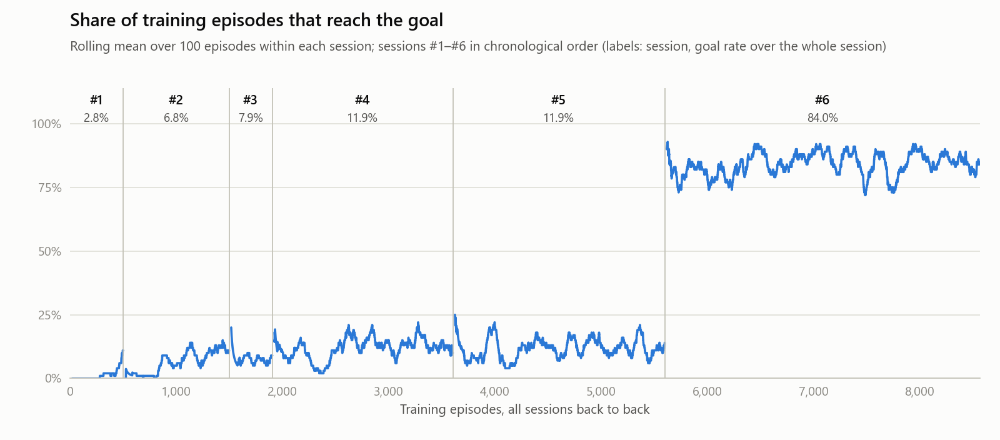
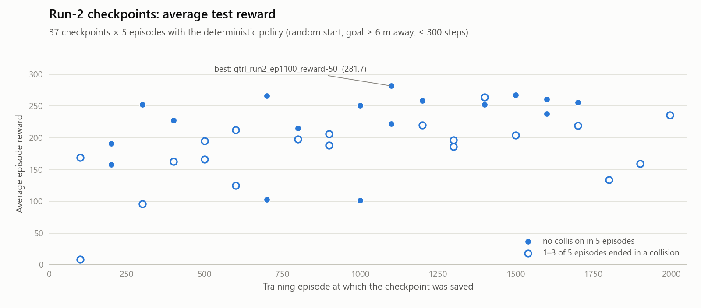

# Transformer RL navigation in Gazebo

A mobile robot learns to drive to a random goal in a simulated indoor lab using only a fisheye-camera image and the goal's distance and bearing, with no map. The policy is a goal-guided transformer trained with soft actor-critic (SAC), and everything runs in Docker (ROS Noetic, Gazebo 11, PyTorch).

This repository contains a research-internship project built on that setup: a GPU training stack in Docker, an AgileX LIMO robot model, training and evaluation tooling, and the logs, curves and checkpoints from 8,569 training episodes across six sessions.

**At a glance**

- Best checkpoint: average test reward **281.7** with **no collisions** in 5 deterministic test episodes (best of 37 evaluated checkpoints).
- Final session: **84.0%** of its 2,969 training episodes reach the goal (earlier sessions: 2.8–11.9%). It also changed the starting checkpoint and the SAC settings, see below.
- The TensorBoard logs of all six sessions, the reward curves and the evaluation summary are in the repo, and `tools/make_figures.py` rebuilds every figure and table below from them.

## Results

### Training sessions

<picture>
  <source media="(prefers-color-scheme: dark)" srcset="docs/figures/training_goal_rate_dark.png">
  
</picture>

| # | Session | Episodes | Reached the goal | Ended in a collision | Goal rate, first → last 100 episodes |
|---|---|--:|--:|--:|:-:|
| 1 | From scratch, seed 525 | 500 | 14 (2.8%) | 476 (95.2%) | 0% → 11% |
| 2 | From scratch, seed 420 | 998 | 68 (6.8%) | 931 (93.3%) | 2% → 11% |
| 3 | Fine-tune of #2 from episode 800 (stopped) | 407 | 32 (7.9%) | 375 (92.1%) | 8% → 9% |
| 4 | Run 2, launch A | 1,700 | 202 (11.9%) | 1,496 (88.0%) | 10% → 10% |
| 5 | Run 2, launch B | 1,995 | 238 (11.9%) | 1,756 (88.0%) | 11% → 14% |
| 6 | Run 3, fine-tune of #4 from episode 1100 | 2,969 | 2,495 (84.0%) | 476 (16.0%) | 83% → 85% |

- In the two from-scratch sessions the goal rate climbs from 0–2% to 11%. Sessions 3–5 reach the goal in 8–12% of their episodes.
- Session 6 starts from the best evaluated checkpoint (session 4, episode 1100) with an initial entropy temperature of about 0.14 (upstream default: 1) and a 2,000-step deterministic warm-up. It reaches the goal in 83% of its first 100 episodes and stays there, so the higher rate is present from the start rather than learned during the session.
- Session 6 ran with the Scout Mini robot model (see [Setup notes](#setup-notes-and-known-limitations)) and took 16.9 hours on one RTX 5080.

### Checkpoint evaluation

<picture>
  <source media="(prefers-color-scheme: dark)" srcset="docs/figures/checkpoint_eval_dark.png">
  
</picture>

All 37 checkpoints from run 2 (sessions 4 and 5) were run for 5 episodes each with the deterministic policy, from a random start to a goal at least 6 m away, with at most 300 steps per episode, in the training world.

| Checkpoint | Average reward | Episodes with a collision |
|---|--:|--:|
| `gtrl_run2_ep1100_reward-50_seed420` | 281.7 | 0 / 5 |
| `gtrl_run2_ep1500_reward-58_seed420` | 267.5 | 0 / 5 |
| `gtrl_run2_ep700_reward1_seed420` | 265.9 | 0 / 5 |
| `gtrl_run2_ep1400_reward-57_seed420` | 264.1 | 1 / 5 |
| `gtrl_run2_ep1600_reward-16_seed420` | 260.6 | 0 / 5 |

Across all 37 checkpoints the average reward has a mean of 198.7 (median 206.1, range 8.5–281.7). 17 checkpoints had no collision, and 26 of the 185 test episodes (14.1%) ended in one. These test scores are far above run 2's training numbers. The two aren't directly comparable: training uses the stochastic (exploring) policy, and the evaluation's robot model and world version weren't logged.

### How to read these numbers

- **Reached the goal** means the episode earned the +100 goal bonus (the robot got within 0.5 m of the goal). **Ended in a collision** means a front-laser reading dropped below 0.5 m (−100). Training rates come from the TensorBoard logs. A handful of episodes log both.
- **Episode reward** is the sum over steps of 20 × progress toward the goal + 2v − |ω| − |Δω|/4, plus the terminal ±100. Because the simulation setup changed between sessions, compare goal and collision rates across sessions rather than rewards.
- **Checkpoint names** carry the 20-episode training mean at save time (`reward-50`), not the test score. A checkpoint saved at the end of a completed session carries that session's own 5-episode end-of-training evaluation instead.
- **Scope.** Each session ran with a single seed (525 for #1, 420 for the rest). The evaluation used 5 episodes per checkpoint in the training world only, and it recorded collisions but not goal success.

## What's in this repository

- **Docker training stack.** `Dockerfile` builds ROS Noetic, Gazebo 11, Python 3.10 (Miniconda) and the latest PyTorch at build time (these runs used 2.12.1 with CUDA 13 on an RTX 5080), with a fix for conda's `libffi` breaking `cv_bridge`. `run_training.sh` starts the container, TensorBoard, training and the post-training plots in one command. `view_logs.sh` and `kill_training.sh` follow and stop a run, and `docker-compose.yaml` gives an interactive shell.
- **AgileX LIMO model.** `xacro/robot/limo/` describes a four-wheel differential-drive LIMO adapted from AgileX's `limo_description`. `xacro/bringup/bringup_limo.xacro` adds the fisheye camera, depth camera and laser, `launch/main_limo.launch` brings it up, and `smoke_test.sh` checks its xacro and ROS topics.
- **Training changes** in `main.py`, `DRL.py` and `config.yaml`:
  - TensorBoard logging of every reward term.
  - A checkpoint every 100 episodes, with the episode number in the file name.
  - Fine-tuning from a saved checkpoint, with the target critic synced to the loaded one.
  - A 2,000-step deterministic warm-up before SAC updates start.
  - Retuned entropy settings: log α starts at −2 and the target entropy is −½·|A|.
  - Fine-tuning hyper-parameters.
- **Evaluation and plots.** `test_all.py` with `run_test_all.sh` evaluates every checkpoint into `results/evaluation_summary.json`. `test.py` with `run_test.sh` evaluates a single checkpoint. `post_training_analysis.py` and `plot_results.py` plot reward curves, and `tools/make_figures.py` builds this README's figures and tables.

## Quick start

You need:

- a Linux host with an NVIDIA GPU, Docker and the NVIDIA Container Toolkit;
- an X display (Gazebo renders the fisheye camera; `run_test_all.sh` uses a virtual display instead);
- internet access while building and when containers start;
- enough RAM for the replay buffer, which is allocated up front: about 31 GB at the default `BUFFER_SIZE: 50000`, so lower it in `config.yaml` on smaller machines.

```bash
docker build -t gotgtrl:noetic .

# Train (settings: catkin_ws/src/gtrl/scripts/SAC/config.yaml)
bash run_training.sh                 # TensorBoard at http://localhost:6006
bash view_logs.sh                    # follow the training log
bash kill_training.sh                # stop

# Evaluate every checkpoint in final_models/ (5 episodes each)
bash run_test_all.sh 5

# Evaluate one checkpoint for 10 episodes
bash run_test.sh gtrl_run2_ep1100_reward-50_seed420 10

# Rebuild the README figures and tables (needs only numpy + matplotlib)
python3 tools/make_figures.py
```

- With `PRE_TRAIN: True` (the default), training fine-tunes `gtrl_run2_ep1100_reward-50_seed420`. Set it to `False` to train from scratch.
- Change `GoT-SAC.name` in `config.yaml` (currently `gtrl_run3`) before starting a new run, or it overwrites session 6's reward curve.
- `run_test_all.sh` overwrites `results/evaluation_summary.json`.

## Repository layout

```
├── Dockerfile, docker-compose.yaml
├── run_training.sh, view_logs.sh, kill_training.sh    training
├── run_test_all.sh, eval_entrypoint.sh, run_test.sh   evaluation
├── smoke_test.sh                                      LIMO bring-up checks
├── plot_results.py                                    quick look at the newest reward curve
├── tools/make_figures.py                              README figures and tables
├── docs/figures/
└── catkin_ws/src/gtrl/
    ├── launch/      main.launch (Scout Mini), main_limo.launch (LIMO), empty_world.launch
    ├── world/       RRC1.world (indoor lab)
    ├── xacro/, meshes/                                robot models and sensors
    └── scripts/
        ├── Environments/env_lab.py                    Gazebo environment: observations, reward, resets
        └── SAC/
            ├── main.py, DRL.py, GoalFormer.py, got_sac_network.py, utils.py, config.yaml
            ├── test.py, test_all.py, post_training_analysis.py, verify_day3.py
            ├── runs/           TensorBoard logs, one folder per session (1–6)
            ├── final_curves/   20-episode mean reward, sessions 1, 3, 5 and 6 (.npy)
            ├── final_models/   checkpoints, see below
            └── results/        evaluation_summary.json
```

### Checkpoints

Each checkpoint is an actor/critic pair (`<prefix>_actor.pth`, `<prefix>_critic.pth`), and loading needs both.

| Prefix | What it is |
|---|---|
| `gtrl_run2_ep1100_reward-50_seed420` | Best evaluated checkpoint (281.7, no collisions), the starting point of session 6 and the default `PRE_TRAIN` checkpoint |
| `gtrl_run3_ep2969_reward276_seed420` | Final checkpoint of session 6; its end-of-training 5-episode evaluation averaged about 276 |

## Setup notes and known limitations

- **Robot model.** `main.py`, `test.py` and `test_all.py` launch `main.launch`, which spawns the AgileX Scout Mini model, and session 6 ran this way. The robot model used in sessions 1–5 and in the checkpoint evaluation was not logged. The LIMO model is included but not wired into training. To use it, point those three scripts at `main_limo.launch` and `env_lab.py` at the `limo` model and its `/limo/*` topics.
- **World.** In the `RRC1.world` included here, 67 of the 91 models are placeholders with no visual or collision geometry. The file was changed to this version after sessions 1–5. The office chairs and white cabinets in it load their meshes from Gazebo Fuel at runtime.
- **Missing meshes.** The base body meshes `limo_base.dae` and `mini_base_link.dae` are not included. Gazebo reports them as missing and draws no base body, but the robots' collision shapes are boxes and still work.

## Based on

The goal-guided transformer encoder, the SAC networks and the environment and reward design come from GoT-GTRL: W. Huang, Y. Zhou, X. He and C. Lv, "Goal-Guided Transformer-Enabled Reinforcement Learning for Efficient Autonomous Navigation", *IEEE Transactions on Intelligent Transportation Systems* 25(2), 2024 ([paper](https://ieeexplore.ieee.org/document/10254445), [code](https://github.com/OscarHuangWind/DRL-Transformer-SimtoReal-Navigation), MIT License). The LIMO description is adapted from AgileX Robotics' `limo_description`.

## License

MIT, see [LICENSE.md](LICENSE.md).
